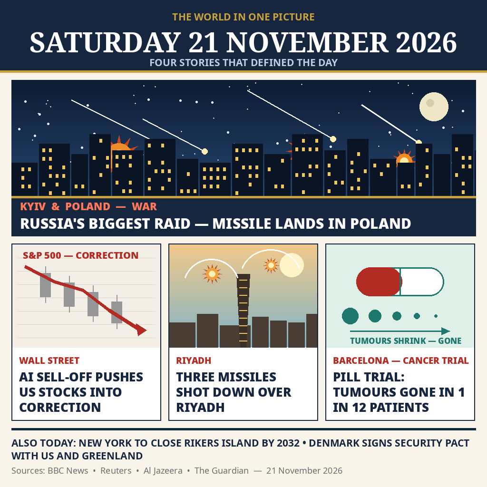

# news-image-20261121

One image summing up the world news of **Saturday, 21 November 2026**:
a drawn newspaper-style poster naming the day, with four major stories
from four regions and fields, plus an "also today" strip.

## The stories

1. **Kyiv & Poland** — Russia launches its biggest raid of the war,
   400+ drones and 110+ missiles; a missile lands in Poland.
2. **Wall Street** — An AI sell-off pushes the S&P 500 and the Dow
   into correction territory.
3. **Riyadh** — Three Houthi ballistic missiles aimed at the capital
   are intercepted, the third night of alerts in a row.
4. **Barcelona** — A pancreatic cancer pill trial reports tumours
   undetectable in 1 in 12 patients.

Also today: New York to close Rikers Island by 2032; Denmark signs a
security pact with the US and Greenland. Sources and dating notes are
in [RESEARCH.md](RESEARCH.md).

## How it works

`main.py` (Python 3.13, standard library only, no network) copies the
pre-rendered poster `news.png` to `$MAKEFUN_OUTPUT_DIR/entry.png`
and self-checks the copy: PNG magic, at most 1024×1024 pixels, at
most 1 MiB. Both runs write byte-identical output.

The poster itself is drawn by `render_poster.py` (Pillow + Noto
fonts, run at build time only) — flat editorial illustration in one
consistent palette, so every label stays crisp and legible.

Entry for the [make.fun bounty](https://make.fun/bounty/news-image-20261121).
